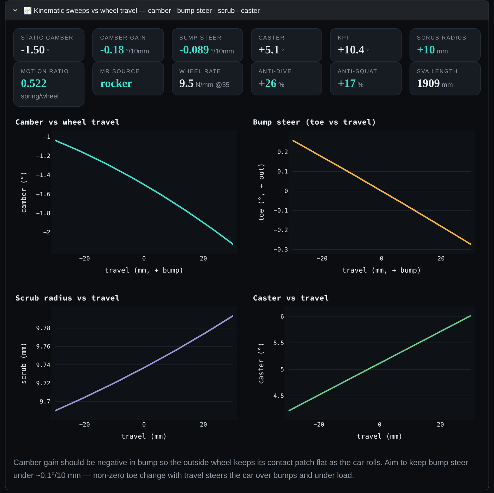
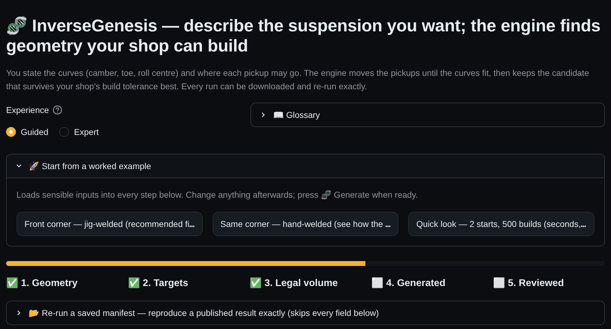
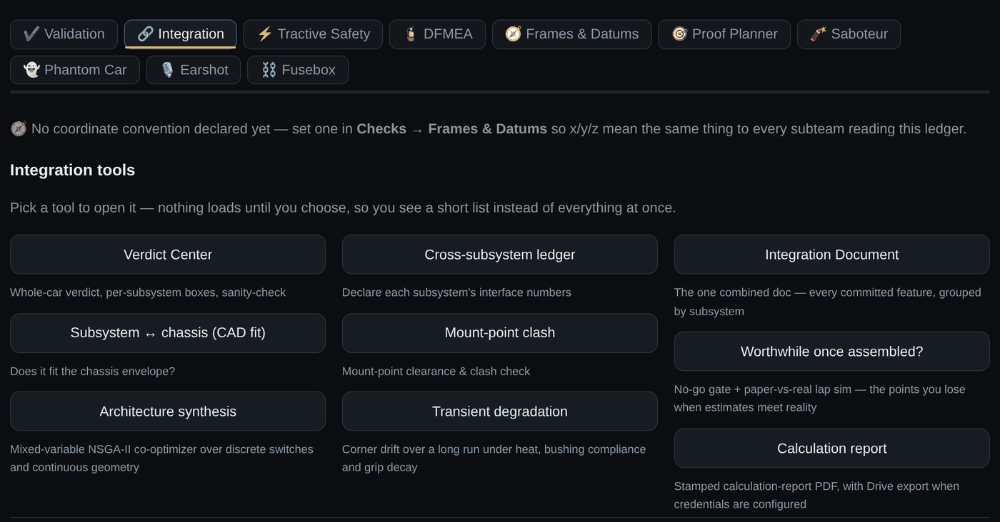

<!--
  KinematiK: Formula SAE / Formula EV pre-validation platform
  Copyright (c) 2026 Frederik Thio. AGPL-3.0.
-->

# KinematiK 

[](https://github.com/frederikexd/kinematik/actions/workflows/tests.yml)
[](https://github.com/frederikexd/kinematik/actions/workflows/codeql.yml)
[](https://github.com/frederikexd/kinematik/actions/workflows/security.yml)
[](https://github.com/frederikexd/kinematik/actions/workflows/lint.yml)
[](https://github.com/frederikexd/kinematik/actions/workflows/reproduce.yml)
[](https://doi.org/10.5281/zenodo.23450788)

The hour before SolidWorks, ANSYS or ADAMS/Car: KinematiK pre-validates Formula Student and Formula student EV design ideas, catching cross-subsystem mistakes in real time and documenting as it goes, reducing the garbage in garbage out effect when using established tools.

**[Open the app](https://kinematik-ijzpvutb92x7n3yzo7sdqc.streamlit.app/)** · Free for student teams · No install needed

The physics and mathematics behind every module are documented in [PHYSICS.md](PHYSICS.md), including the derivations and their test coverage. What has been checked against other tools, and what has not, is in [VALIDATION.md](VALIDATION.md); every benchmark test, listed by role and feature, is in [BENCHMARK.md](BENCHMARK.md). If you find an error in the math, open an issue.

---

## What it's for

You make design decisions before you have CFD or FEA results. KinematiK is the
step in between: fast enough to try twenty ideas, honest enough to tell you when
it can't answer.

It is not a replacement for ANSYS, ADAMS or MATLAB. It is what you run *before*
them, so the two concepts you take to a real solver are the two worth the hours.

## What it does

| | |
|---|---|
| **Suspension** | 3D constraint solver: double wishbone, MacPherson, multi-link, solid axle. Camber gain, bump steer, roll centre migration, load transfer. |
| **Aero** | Underfloor duct model, vortex lattice for wings, source-panel method for bluff bodies. Upload an STL, get a ride-height sweep. |
| **Brakes** | Bias, lock-up, hydraulic sizing, rotor thermal and fade. |
| **Accumulator** | Cell sizing, pack topology, FSAE-EV rules checks, thermal model. |
| **Chassis** | Frame graph with triangulation and load-path audit, weight and CG ledger. |
| **Electrics** | Import a real routed board (KiCad, Altium) and check copper survival and signal integrity. |
| **Powertrain** | Iterate motor architecture, check which one finishes fastest and which configuration blows a fuse. |
| **Integration** | Every subsystem declares mass, CG, torque, heat and load into one ledger. Change a number, see which other subsystems it moves. |

Most tabs export a build-ready DXF you can open in SolidWorks as a 2D sketch.

Full list: **[FEATURES.md](FEATURES.md)**

## Screenshots

Kinematic sweeps from the live hardpoints:



InverseGenesis, the inverse synthesis: state the curves, get buildable pickups:



Integration tools, where every subsystem's numbers meet:



## Aero example

Upload an STL, pick a solver, get a ride-height sweep:

The what-if grid solves 30 combinations of throat position and ride height in
milliseconds, with the diffuser separation limit marked:

```
 ride       25%       35%       45%       55%       65%
   60      -36%      -37%      -38%      -39%      -40%
   40       +6%       +3%       +0%       -3%       -6%
   25     +102%      +92%      +84%      +76%      +68%
   20     +180%     +164%     +152%     +139%     +126%
```

Ten millimetres of ride height is worth more than any throat position available.
That's the kind of answer this is for.

## Run it locally

```bash
git clone https://github.com/<your-org>/kinematik.git
cd kinematik
pip install -r requirements.txt
streamlit run fsae_suspension/streamlit_app.py
```

Python 3.11+. The hosted app needs no install.

---

## Known limitations

- **Not correlated with a measured car.** The kinematics agree with Adams View,
  Lotus Suspension Analysis and Applied Racing Dynamics, and the synthesis reproduces
  on other teams' machines ([VALIDATION.md](VALIDATION.md)), but nothing has been
  compared with an instrumented vehicle, a K&C rig or a wind tunnel. Treat every
  number as a starting point for your own test day.
- **Synthetic default tyre.** Load your own Magic Formula coefficients for
  absolute grip numbers.
- **Quasi-static and lumped models.** Lap time, load transfer and the thermal
  models give trends, not transients.
- **Inviscid aero.** The panel method matches a sphere in potential flow (Cp
  minimum −1.248 against −1.250), and the vortex lattice lands 11% under
  lifting-line theory on a rectangular AR 8 wing. Neither sees separation or
  stall. On a cambered body the absolute C_L drifts a few percent per mesh
  refinement while the ratio between two geometries holds to 3%, so compare
  designs at matched settings rather than quoting one figure.
- **Not peer reviewed yet.** A manuscript is in preparation.
- **One author.** That is why every published number has a script
  that re-runs it, and why the checks run weekly in CI.

**It tells you when it can't answer.** Diverged cases are blanked rather than
printed. Grid checks that couldn't run say so instead of reporting a reassuring
0%. Every failure message names the lever that's actually available for your
case.

## Contributing

See [CONTRIBUTING.md](CONTRIBUTING.md). Issues and pull requests welcome.
Deployment and database notes are in [DEPLOY.md](DEPLOY.md); release
history is in [CHANGELOG.md](CHANGELOG.md).

## License

AGPL-3.0

Original work of Frederik Thio. © 2026.
