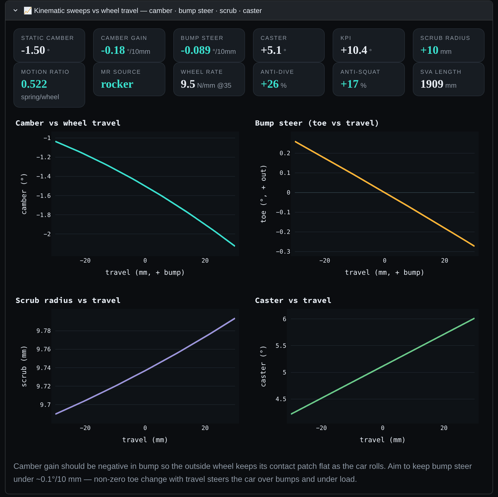
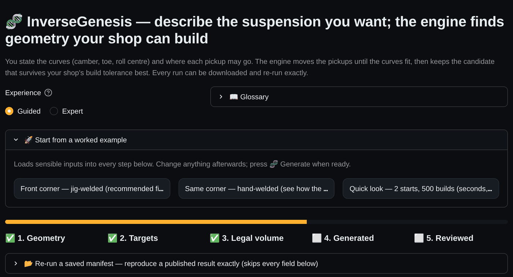
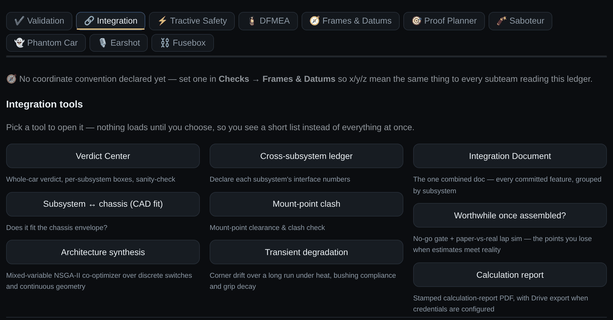

<!--
  KinematiK: Formula Student / Formula student EV pre-validation platform
  Copyright (c) 2026 Frederik Thio. AGPL-3.0.
-->

# KinematiK 

[](https://github.com/frederikexd/kinematik/actions/workflows/tests.yml)
[](https://github.com/frederikexd/kinematik/actions/workflows/codeql.yml)
[](https://github.com/frederikexd/kinematik/actions/workflows/security.yml)
[](https://github.com/frederikexd/kinematik/actions/workflows/lint.yml)
[](https://github.com/frederikexd/kinematik/actions/workflows/reproduce.yml)
[](https://github.com/frederikexd/kinematik/actions/workflows/mutation.yml)
[](https://doi.org/10.5281/zenodo.23450788)

**KinematiK catches the problems that fall between teams, starting with the one that blows fuses: powertrain current versus electrical hardware.**

The hour before SolidWorks, ANSYS or ADAMS/Car: KinematiK pre-validates Formula Student and Formula student EV design ideas, catching cross-subsystem mistakes in real time and documenting as it goes, reducing the garbage in garbage out effect when using established tools.

**[Open the app](https://kinematik-ijzpvutb92x7n3yzo7sdqc.streamlit.app/)** · Free for student teams · No install needed

The physics and mathematics behind every module are documented in [PHYSICS.md](PHYSICS.md), including the derivations and their test coverage. What has been checked against other tools, and what has not, is in [VALIDATION.md](VALIDATION.md); every benchmark test, listed by role and feature, is in [BENCHMARK.md](BENCHMARK.md). If you find an error in the math, open an issue.

### Benchmarked against established tools

The suspension kinematics solver has been checked against three established tools and an independent solve that shares no code with it. The limits were set before each run.

| Checked against | Corners | Largest difference |
|---|---|---|
| Adams View 2026.1 | The paper's three corners, every 1 mm over ±25 mm | Camber, toe, caster and KPI within 0.00003°; wheel-centre path within 0.00003 mm (limits 0.005–0.01° and 0.05 mm) |
| Lotus Suspension Analysis | Two published corners (Arévalo et al., 2018) | Camber in bump 0.009°, toe in bump 0.0003°, camber in roll 0.008° (Lotus values read from the published figures) |
| Applied Racing Dynamics | Front and rear corners, static and ±20 mm | Static caster, KPI, scrub and motion ratio to ARD's display precision; camber change within 0.014°; larger differences traced to definitions |
| Independent rigid-body solve | Three corners | Camber and toe within 1e-12° |

These check the kinematics solver, not a built car; what has not been checked yet is listed in [VALIDATION.md](VALIDATION.md).

The EV and combustion powertrain logic has been checked against four independent references
([details](docs/POWERTRAIN_VALIDATION.md)). The blind rounds were sealed and pushed to GitHub before they ran.

| Checked against | Cases | Result |
|---|---|---|
| NREL FASTSim 3.1.0, identical inputs | 5 vehicles × 4 drive cycles, plus a sixth car never used before | 20 of 20; worst energy difference 0.04 % (the sixth car within 0.04 % too) |
| Five published GT-SUITE studies | BMW i3, a 12 t truck, an e-two-wheeler, two passenger cars | 41 of 44 results within 5 %; the misses traced to the papers' own gaps |
| MathWorks' Simscape Formula Student model, blind | 7 sealed cases: laps, skidpad, launches | 28 of 39 metrics within 3 %; energy, current, voltage, pack resistance and the 75 m launch 28 of 29 |
| Measured data | Argonne National Laboratory dyno (BMW i3, Chevrolet Blazer); a Formula Student team's race telemetry | Energy 3.7 % and fuel 3.8 % on average; launch within 1 %; pack voltage sag 3.7 % |

And because a pre-validation tool has to stop wrong inputs before they reach the tools downstream, a sealed
garbage-in benchmark feeds it realistic input errors (pounds for kilograms, efficiency in percent, inverted ratios,
random typos) ([details](docs/GIGO_BENCHMARK_PLAN.md)):

| Round | Harmful errors caught at entry | As a second opinion beside FASTSim | False alarms |
|---|---|---|---|
| 1, before entry checks | 0 of 120 | 99 of 99 | 0 |
| 2, plausibility checks added | 65 of 119 (18 of 20 on the Formula Student car) | 99 of 99 | 0 |
| 3, cars the checks were never written against | **64 of 83 on two Formula Student cars (77 %, 95 % CI 67–85 %)** | 23 of 23 | 0 |

The electrical modules were checked against KiCad 7, SPICE (ngspice) and a 2-D field solver (atlc, standing in for
Altium's impedance calculator, which can't run from this repo directly). Limits were set before each run
([details](docs/ELECTRICAL_BENCHMARK.md)):

| Checked against | Cases | Result |
|---|---|---|
| KiCad 7's own reader | KiCad's 14 demo boards: about 15,000 tracks, 1,260 vias, 4,869 pads | Exact on every count, net width and pad position; net lengths within 0.009 mm |
| SPICE: precharge and the pack over a lap | 4 precharge circuits; a 520-point lap with regen | Within 0.001 % and 0.0011 % |
| SPICE: net resistance on real boards | 963 nets | **Missed the 2 % limit.** Four connectivity flaws found and fixed; now 72.5 % within 2 %, 91.8 % within 10 % (same boards) |
| Corrected 2-D copper solve: net resistance, held-out FS team boards | 142 sampled nets | **Still misses 2 % on 13 %, reading high.** 87.3 % within 2 %, 97.9 % within 5 %, median +0.55 %, worst low −3.1 % (was 2.8 % within 2 %, median +16.9 %) |
| Altium Designer 26: board reading and impedance calculator | 3 boards; 21 cross-sections | Counts equal Altium's (after 2 reader fixes); impedance 21 of 21 within limits, worst 4.0 % |
| Trace heating vs NBS 1956 measurements | 44 points | IPC-2221 × 0.975: 44 of 44 within 5 % (calibrated on these points) |
| Altium Designer 26.11.1, native Altium boards | 6 team boards designed in Altium | 30 of 30 counts identical |
| KiCad 9.0.3, boards saved in KiCad 8–9 | 4 team boards: 6,068 tracks, 505 nets | Every count identical; net lengths within 0.015 % |
| 2-D solve of KiCad 9's copper, net resistance held out | 100 nets, then 100 more for the fix | 1-D model: **miss**, 70 of 95 within 2 % (all within 10 %). Sheet-solve refinement, held out: **92 of 92 within 2 %**. What reports use at the shipped size limit: **91 of 92 within 2 %**, the rest reading high |
| Nets with copper pours (pours up to ~100 mm²), held out | 204 fresh nets on 39 boards, registered random order | **203 of 204 within 2 %**; the miss (+3.1 %, roundrect corners) fixed and held out on 53 more: 53 of 53. Large planes (34–131 mm²): 7 of 7 within 2 %, opt-in because they are much slower to solve |
| atlc field solver: microstrip impedance | 11 cases, then 10 unseen | IPC-2141 missed by up to 8.3 %; replaced by Hammerstad–Jensen, 10 of 10 unseen within 3.4 % |

**Check it yourself**: copy and paste the commands below; each set takes a few minutes on a laptop. Think a result is
wrong? [Break it](CHALLENGE.md).

Setup, once:

```bash
git clone https://github.com/frederikexd/kinematik.git
cd kinematik
pip install -r requirements.txt
cd fsae_suspension
```

Electrical benchmarks (PCB Doctor, SPICE, impedance, heating; accumulator and harness against ngspice, PyBaMM and
liionpack; the parallel split against 54 measured modules):

```bash
pytest tests/test_electrical_benchmark.py tests/test_pcb_doctor.py tests/test_ev_electrical_check.py \
       tests/test_pcb_upload_fuzz.py tests/test_accumulator_harness_benchmark.py \
       tests/test_parallel_module_benchmark.py
```

EV/ICE powertrain benchmarks:

```bash
pytest tests/test_fastsim_benchmark.py tests/test_gt_suite_benchmark.py tests/test_powertrain_benchmark.py \
       tests/test_gigo_benchmark.py tests/test_gigo_round3.py tests/test_plausibility.py
```

Suspension benchmarks: 

```bash
pytest tests/test_adams_view_benchmark.py tests/test_lotus_benchmark.py tests/test_invariants_property.py
python scripts/verify_run.py manifests/rear_v11_final.recorded.genesis.json   # re-solves a final corner, about 4 min
```

---

## What it's for

You make design decisions before you have CFD or FEA results. KinematiK is the
step in between: fast enough to try twenty ideas, honest enough to tell you when
it can't answer.

It is not a replacement for ANSYS, ADAMS or MATLAB. It is what you run *before*
them, so the two concepts you take to a real solver are the two worth the hours.

## What it does

| | |
|---|---|
| **Suspension** | 3D constraint solver: double wishbone, MacPherson, multi-link, solid axle. Camber gain, bump steer, roll centre migration, load transfer. |
| **Aero** | Underfloor duct model, vortex lattice for wings, source-panel method for bluff bodies. Upload an STL, get a ride-height sweep. |
| **Brakes** | Bias, lock-up, hydraulic sizing, rotor thermal and fade. |
| **Accumulator** | Cell sizing, pack topology, FSAE-EV rules checks, thermal model. |
| **Chassis** | Frame graph with triangulation and load-path audit, weight and CG ledger. |
| **Electrics** | Import a real routed board (KiCad, Altium) and check copper survival and signal integrity. |
| **Powertrain** | Iterate motor architecture, check which one finishes fastest and which configuration blows a fuse. |
| **Integration** | Every subsystem declares mass, CG, torque, heat and load into one ledger. Change a number, see which other subsystems it moves. |

Most tabs export a build-ready DXF you can open in SolidWorks as a 2D sketch.

Full list: **[FEATURES.md](FEATURES.md)**

## Screenshots

Kinematic sweeps from the live hardpoints:



InverseGenesis, the inverse synthesis: state the curves, get buildable pickups:



Integration tools, where every subsystem's numbers meet:



## Aero example

Upload an STL, pick a solver, get a ride-height sweep:

The what-if grid solves 30 combinations of throat position and ride height in
milliseconds, with the diffuser separation limit marked:

```
 ride       25%       35%       45%       55%       65%
   60      -36%      -37%      -38%      -39%      -40%
   40       +6%       +3%       +0%       -3%       -6%
   25     +102%      +92%      +84%      +76%      +68%
   20     +180%     +164%     +152%     +139%     +126%
```

Ten millimetres of ride height is worth more than any throat position available.
That's the kind of answer this is for.

## Run it locally

```bash
git clone https://github.com/frederikexd/kinematik.git
cd kinematik
pip install -r requirements.txt
streamlit run fsae_suspension/streamlit_app.py
```

Python 3.12 or newer. The hosted app needs no install.

## Check a board offline

No upload, no account: the check runs on your machine and writes a report another engineer can reproduce from the
same two files (both are hashed in the report).

```bash
cd kinematik/fsae_suspension
pip install -e .
kinematik-check my_board.kicad_pcb --loads loads.csv --report report.md --json report.json
```

`loads.csv` is what the powertrain or systems side declares, one row per powered net:

```csv
net,current_a,voltage_v,owner
STATOR_PWR,25,12,powertrain
```

It checks each declared current against the fuses, traces and copper that carry it, flags declared loads that are
not on the board and board nets nobody declared, and states the evidence behind every result. Exit status is 1 on
any FAIL (or WARN with `--fail-on warning`), so it can gate a CI run. KiCad and Altium boards.

---

## Known limitations

- **Not correlated with a measured car.** The kinematics agree with Adams View,
  Lotus Suspension Analysis and Applied Racing Dynamics, and the synthesis reproduces
  on other teams' machines ([VALIDATION.md](VALIDATION.md)), but nothing has been
  compared with an instrumented vehicle, a K&C rig or a wind tunnel. Treat every
  number as a starting point for your own test day.
- **Powertrain heat and lap time.** Pack and motor heat are over-predicted by 3.5–14 % against Simscape (the safe
  side for cooling); lap time has not been compared with a real car; a Formula Student engine's fuel map and coolant
  heat have no open reference. Wrong inputs that still look like a believable car (a driver left out of the mass, an
  efficiency off by a dropped digit) are not caught by the entry checks.
- **Synthetic default tyre.** Load your own Magic Formula coefficients for
  absolute grip numbers.
- **Quasi-static and lumped models.** Lap time, load transfer and the thermal
  models give trends, not transients.
- **Inviscid aero.** The panel method matches a sphere in potential flow (Cp
  minimum −1.248 against −1.250), and the vortex lattice lands 11% under
  lifting-line theory on a rectangular AR 8 wing. Neither sees separation or
  stall. On a cambered body the absolute C_L drifts a few percent per mesh
  refinement while the ratio between two geometries holds to 3%, so compare
  designs at matched settings rather than quoting one figure.
- **Not peer reviewed yet.** A manuscript is in preparation.
- **One author.** That is why every published number has a script
  that re-runs it, and why the checks run weekly in CI.

**It tells you when it can't answer.** Diverged cases are blanked rather than
printed. Grid checks that couldn't run say so instead of reporting a reassuring
0%. Every failure message names the lever that's actually available for your
case.

## Contributing

See [CONTRIBUTING.md](CONTRIBUTING.md). Issues and pull requests welcome. Think a result is wrong?
[Break it](CHALLENGE.md): confirmed breaks and independent reproductions are credited there by name.
Deployment and database notes are in [DEPLOY.md](DEPLOY.md); release
history is in [CHANGELOG.md](CHANGELOG.md).

## License

AGPL-3.0

Original work of Frederik Thio. © 2026.
