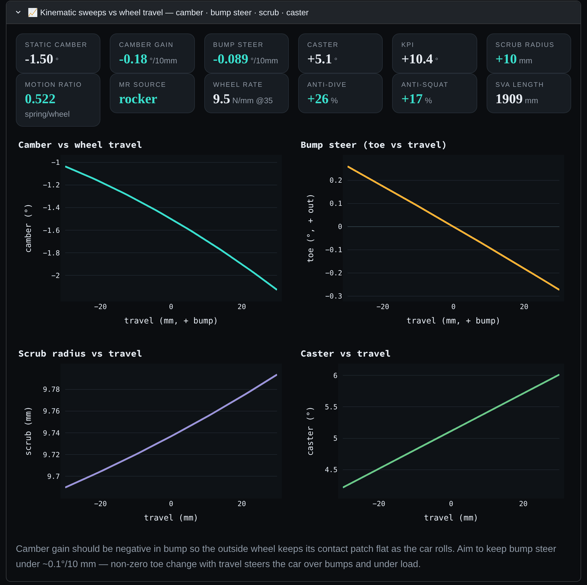
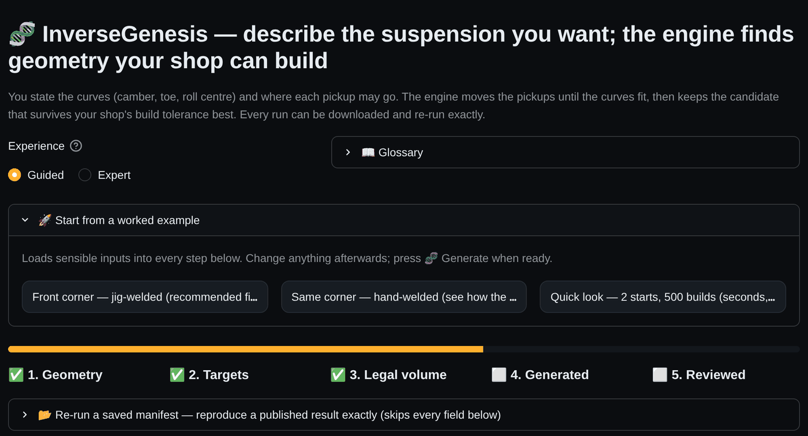
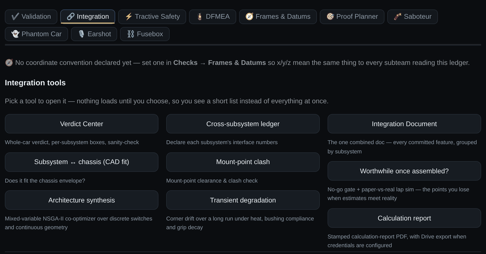

<!--
  KinematiK: Formula Student / Formula Student EV pre-validation platform
  Copyright (c) 2026 Frederik Thio. AGPL-3.0.
-->

# KinematiK

[](https://github.com/frederikexd/kinematik/actions/workflows/tests.yml)
[](https://github.com/frederikexd/kinematik/actions/workflows/codeql.yml)
[](https://github.com/frederikexd/kinematik/actions/workflows/security.yml)
[](https://github.com/frederikexd/kinematik/actions/workflows/lint.yml)
[](https://github.com/frederikexd/kinematik/actions/workflows/reproduce.yml)
[](https://github.com/frederikexd/kinematik/actions/workflows/mutation.yml)
[](https://doi.org/10.5281/zenodo.23450788)

Pre-validation for Formula Student and Formula Student EV design work: suspension, powertrain, electrics, brakes,
aero and chassis calculations you run before SolidWorks, ANSYS or Adams, so the concepts that reach those tools are
the ones worth the hours, and the mistakes between subsystems are caught before they are built in.

It is not a replacement for those tools or for test data once a car exists (see [Known limitations](#known-limitations)).

**[Open the app](https://kinematik-ijzpvutb92x7n3yzo7sdqc.streamlit.app/)** · free for student teams · no install ·
open source (AGPL-3.0)

## How the numbers here are checked

1. **The same problem goes into an established tool** (Adams View, MATLAB Simscape, Ansys, Nastran, KiCad, SPICE and
   others) or a published result from one, with identical inputs.
2. **The pass limit is written down before the run** and committed with the benchmark.
3. **The result is published either way.** Misses stay in, with what caused them ([below](#what-missed)).
4. **A script re-runs it.** The commands are under [Re-run the benchmarks](#re-run-the-benchmarks).

CI runs the tests, lint, CodeQL and security scans on every push to main, re-solves the recorded design runs every
week, and holds the core files listed in `mutation_targets.toml` to a 99 % mutation score.

### Check one by hand

Ansys's own Verification Manual, problem VM16: a cantilever 10 in long and 2 in deep, 1 in thick (Ansys's default for
plane elements), with 300 lb on the free end. Bending stress 1 in from the wall:

σ = M·c / I = 6·F·a / (b·h²) = 6 × 300 lb × 9 in / (1 in × (2 in)²) = **4,050 psi**

with F the end load, a = 10 in − 1 in = 9 in the distance from that section to the load, b = 1 in the thickness
and h = 2 in the depth (I = b·h³/12, c = h/2).

| | Bending stress |
|---|---|
| Hand calculation (above) | 4,050 psi |
| Ansys Mechanical APDL, published | 4,050 psi |
| KinematiK bracket check | 4,050 psi |

The same comparison against the published results of three more commercial solvers for the bracket check, and of
three for the MorphMesh plate solver:

| Problem (source) | KinematiK feature | Tool's published result | Theory | KinematiK |
|---|---|---|---|---|
| 2D cantilever plate, root stress (Creo mvss003) | Bracket check | MSC Nastran 55,190 psi; Creo Simulate 60,121 psi | 60,000 psi | 60,000 psi |
| Thin cantilever wall, root stress (Autodesk Nastran 2.9) | Bracket check | Autodesk Nastran 20,535 psi | 21,600 psi | 21,600 psi |
| MacNeal–Harder straight cantilever, tip deflection | MorphMesh | Ansys 0.1068 in; Autodesk Nastran 0.1072 in; Abaqus 0.108 in | 0.108 in (0.1081 with shear) | 0.1072 in |

The bracket check is the beam formula, so it returns the theory value exactly; the solvers' published numbers
differ because they mesh the part. That shows the formula is implemented correctly, not that a hand calculation beats
FEA (where it doesn't, see [What missed](#what-missed)).

Run it in under a minute, from `kinematik/fsae_suspension` after the [install](#run-it-locally):

```bash
pytest tests/test_gold_standard_benchmark.py tests/test_ansys_vm16_benchmark.py
```

## Benchmark highlights

| Area | Checked against | Result |
|---|---|---|
| Suspension kinematics | Adams View 2026.1, Lotus Suspension Analysis, Applied Racing Dynamics, MathWorks' K&C rig (Simscape), Project Chrono | Camber, toe, caster and kingpin inclination within 0.00003° of Adams View at every 1 mm of wheel travel over ±25 mm; 500 random corners within 0.000025° of Chrono |
| Geometry and steering | Adams View 2026.1, MATLAB Simscape Multibody R2025b, Project Chrono 9.0.1 | Contact-patch path within 0.00012 mm, anti-dive and anti-squat within 0.0007 percentage points, Ackermann at lock within 0.0003 percentage points |
| Link loads | Adams View, Simscape Multibody, Chrono, an independent static solve | Member forces within 0.0009 N of Adams View (3 corners × 4 load cases; limit 0.5 N + 0.1 %) |
| Brackets and plate FE | Published verification problems of Ansys, MSC Nastran, Creo Simulate, Autodesk Nastran and Abaqus (above); scikit-fem, SfePy and OpenSees | Bracket root-bending stress equals each manual's theory value; the plate solver (MorphMesh) within 0.01–0.71 % of the tools' published deflections |
| Powertrain | NREL FASTSim 3.1.0, five published GT-SUITE studies, MathWorks' Formula Student model (blind), Argonne dyno data | FASTSim 20 of 20 within 0.04 %; GT-SUITE 41 of 44 within 5 %; blind 28 of 39 within 3 %; dyno energy 3.7 % on average |
| Electrics | KiCad 7 and 9, Altium Designer 26, SPICE (ngspice), PyBaMM, liionpack | Board reading exact on every count (30 of 30 on native Altium boards); precharge within 0.001 %; net resistance with copper pours 203 of 204 within 2 % |
| Wrong inputs | Sealed rounds of realistic input errors (pounds for kilograms, percent for fraction, typos) | 64 of 83 harmful errors caught at entry on two cars the checks were never written against, 0 false alarms |

Full tables, limits and links to each run: [BENCHMARK.md](BENCHMARK.md), [VALIDATION.md](VALIDATION.md),
[powertrain](docs/POWERTRAIN_VALIDATION.md), [electrical](docs/ELECTRICAL_BENCHMARK.md),
[wrong inputs](docs/GIGO_BENCHMARK_PLAN.md).

### What missed

- **Two published Lotus SHARK studies:** camber and toe pass; caster, kingpin inclination, damper ratio and one paper's +30 mm values
  miss. Chrono solves the published hardpoints exactly as KinematiK does, so those rows don't follow from the papers'
  own hardpoints ([details](fsae_suspension/benchmarks/published_lotus/README.md)).
- **MathWorks' K&C rig:** caster, kingpin inclination and trail (and rear scrub) miss, because MathWorks estimates them from the
  steering test ([details](fsae_suspension/benchmarks/knc_simscape/README.md)).
- **MathWorks' Formula Student model, blind:** 11 of 39 metrics outside 3 %.
- **Net resistance:** the first SPICE round missed its 2 % limit (four connectivity flaws, fixed); on held-out team
  boards the 2-D copper solve still reads high on 13 % of nets.
- **Bugs the benchmarks found:** the 500-corner Chrono run found a rocker-solve bug, the SPICE runs four connectivity
  flaws, the solder-bridge screen two missed custom pads. All fixed and re-run.
- **Brackets:** at a fully fixed root, 3D FEA puts the stress 12–47 % above the hand calculation, so a tab whose root
  governs still needs FEA.

All of these check the maths against the established tools, which is what pre-validation needs. See
[Known limitations](#known-limitations).

## Screenshots

Kinematic sweeps from the live hardpoints:



InverseGenesis, the inverse synthesis: state the curves, get buildable pickups:



Integration tools, where every subsystem's numbers meet:



## What it does

| | |
|---|---|
| **Suspension** | 3D constraint solver: double wishbone, MacPherson, multi-link, solid axle. Camber gain, bump steer, roll-centre migration, load transfer, link loads. |
| **Aero** | Underfloor duct model, vortex lattice for wings, source-panel method for bluff bodies. Upload an STL, get a ride-height sweep. |
| **Brakes** | Bias, lock-up, hydraulic sizing, rotor thermal and fade. |
| **Accumulator** | Cell sizing, pack topology, FSAE-EV rules checks, thermal model. |
| **Chassis** | Frame graph with triangulation and load-path audit, bracket factor of safety, weight and CG ledger. |
| **Electrics** | Import a routed board (KiCad, Altium) and check current capacity, voltage drop, clearance and impedance. |
| **Powertrain** | Compare motor architectures: which finishes fastest, and which configuration blows a fuse. |
| **Integration** | Every subsystem declares mass, CG, torque, heat and load into one ledger. Change a number, see which other subsystems it moves. |

Most tabs export a DXF you can open in SolidWorks as a 2D sketch. Full list: [FEATURES.md](FEATURES.md).

## Run it locally

```bash
git clone https://github.com/frederikexd/kinematik.git
cd kinematik
pip install -r requirements.txt
streamlit run fsae_suspension/streamlit_app.py
```

Python 3.12 or newer. The hosted app needs no install.

### Re-run the benchmarks

From `kinematik/fsae_suspension`, each set takes a few minutes on a laptop.

Suspension:

```bash
pytest tests/test_adams_view_benchmark.py tests/test_lotus_benchmark.py tests/test_invariants_property.py \
       tests/test_link_load_benchmark.py tests/test_direct_acting_benchmark.py tests/test_direct_acting.py \
       tests/test_adams_geometry_benchmark.py tests/test_adams_steering_benchmark.py \
       tests/test_published_lotus_benchmark.py tests/test_random_geometry_benchmark.py
python scripts/verify_run.py manifests/rear_v11_final.recorded.genesis.json   # re-solves a final corner, about 4 min
```

Brackets and plate FE (the live FEA re-runs need `pip install scikit-fem sfepy openseespy`; without them the
recorded runs are checked):

```bash
pytest tests/test_gold_standard_benchmark.py tests/test_ansys_vm16_benchmark.py \
       tests/test_bracket_fea_benchmark.py tests/test_morphmesh_benchmark.py
```

Powertrain:

```bash
pytest tests/test_fastsim_benchmark.py tests/test_gt_suite_benchmark.py tests/test_powertrain_benchmark.py \
       tests/test_gigo_benchmark.py tests/test_gigo_round3.py tests/test_plausibility.py
```

Electrics (PCB Doctor, SPICE, impedance, heating, accumulator and harness, the parallel split against 54 measured
modules):

```bash
pytest tests/test_electrical_benchmark.py tests/test_pcb_doctor.py tests/test_ev_electrical_check.py \
       tests/test_pcb_upload_fuzz.py tests/test_accumulator_harness_benchmark.py \
       tests/test_parallel_module_benchmark.py tests/test_bridge_screen.py
```

## Check a board offline

No upload, no account: the check runs on your machine and writes a report another engineer can reproduce from the
same two files (both are hashed in the report).

```bash
cd kinematik/fsae_suspension
pip install -e .
kinematik-check my_board.kicad_pcb --loads loads.csv --report report.md --json report.json
```

`loads.csv` is what the powertrain or systems side declares, one row per powered net:

```csv
net,current_a,voltage_v,owner
STATOR_PWR,25,12,powertrain
```

It checks each declared current against the fuses, traces and copper that carry it, flags declared loads that are
not on the board and board nets nobody declared, and states the evidence behind every result. Exit status is 1 on
any FAIL (or WARN with `--fail-on warning`), so it can gate a CI run. KiCad and Altium boards.

## Known limitations

- **Pre-validation, not correlation.** KinematiK checks designs before there is a car. The evidence for that is that
  its maths matches the established tools a team validates with later (above). It is not a substitute for test data
  once a car exists: treat every number as a starting point for your own test day.
- **Powertrain heat and lap time.** Pack and motor heat are over-predicted by 3.5–14 % against Simscape (the safe
  side for cooling); lap time has not been compared with a real car; a Formula Student engine's fuel map and coolant
  heat have no open reference. Wrong inputs that still look like a believable car (a driver left out of the mass, an
  efficiency off by a dropped digit) are not caught by the entry checks.
- **Synthetic default tyre.** Load your own Magic Formula coefficients for absolute grip numbers.
- **Quasi-static and lumped models.** Lap time, load transfer and the thermal models give trends, not transients.
- **Inviscid aero.** The panel method matches a sphere in potential flow (Cp minimum −1.248 against −1.250), and the
  vortex lattice lands 11 % under lifting-line theory on a rectangular AR 8 wing. Neither sees separation or stall.
  Compare designs at matched settings rather than quoting one absolute figure.
- **Brackets are screened, not simulated.** Bolt bearing, tear-out and weld throat are hand calculations without an
  outside benchmark, and a fully fixed root sees more stress than the hand value.
- **Not peer reviewed yet.** The manuscript has had technical reviews from industry engineers, credited in its acknowledgments, and is being prepared for journal submission.

## Acknowledgments

Dan Jones (Chief Judge at Formula Student) reviewed the judge summary output; at his suggestion, the judge's likely questions and the limits of the
pre-validation moved to a separate design-review notes report. Acknowledgment records feedback received and does not
imply endorsement.

## Contributing

See [CONTRIBUTING.md](CONTRIBUTING.md). Issues and pull requests welcome. Deployment and database notes are in
[DEPLOY.md](DEPLOY.md); release history is in [CHANGELOG.md](CHANGELOG.md).

## License

AGPL-3.0. Original work of Frederik Thio. © 2026.
